

  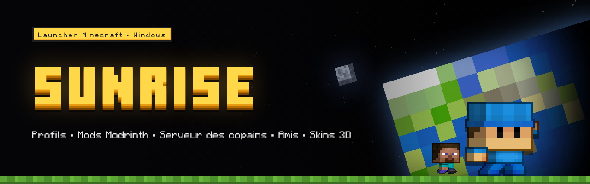

  
  
  

<h3 align="center">
  <a href="https://github.com/YutsiOFF/SUNRISE-Updates/releases/latest">⬇ Télécharger SUNRISE</a> ·
  <a href="https://yutsioff.github.io/SUNRISE-Updates/">🌐 Site officiel</a>
</h3>

---

**SUNRISE** est le launcher Minecraft des copains, entièrement habillé en pixel : boutons en relief, panneaux en pierre et polices du jeu. Il gère pour toi Java, les profils, les mod-loaders et les mods, et il se met à jour tout seul.

  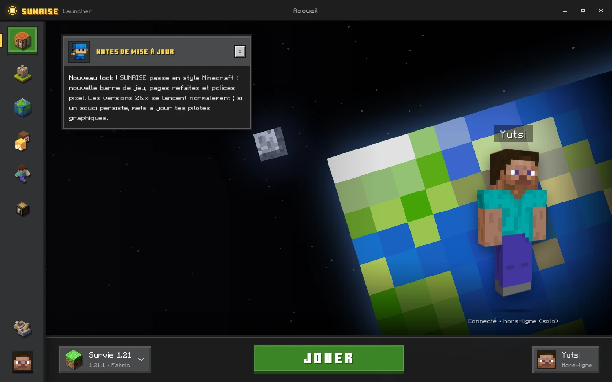

## ✨ Fonctionnalités

| | |
|---|---|
| 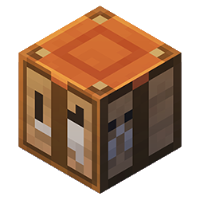 | **Jouer en un clic.** Choisis ton profil dans la barre de jeu, appuie sur **JOUER** : Java, assets et librairies sont installés automatiquement. |
| 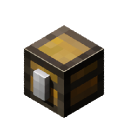 | **Profils illimités.** Version, Vanilla / Fabric / Forge / NeoForge et une icône de bloc pour chaque monde. |
| 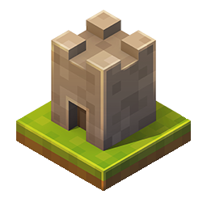 | **Mods Modrinth.** Mods, shaders, texture packs et addons installés dans le bon profil avec le bon loader. |
| 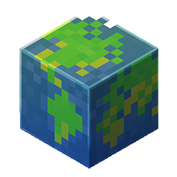 | **Serveur des copains.** `mc-copaing` (1.21.1 Fabric) avec les joueurs en direct ; le profil et les mods du serveur s'installent tout seuls. |
| 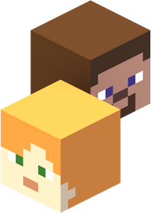 | **Réseau d'amis.** Demandes d'amis d'un launcher à l'autre, statut en ligne, bouton pour rejoindre. |
| 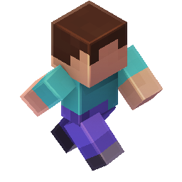 | **Skins & capes 3D.** Ton skin en 3D sur l'accueil, changement classic / slim, capes de ton compte Microsoft. |
| 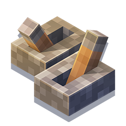 | **Mises à jour automatiques.** Une notification apparaît dans le launcher, un clic et la nouvelle version remplace l'ancienne. |

## 🖼️ Captures

<table>
  <tr>
    <td>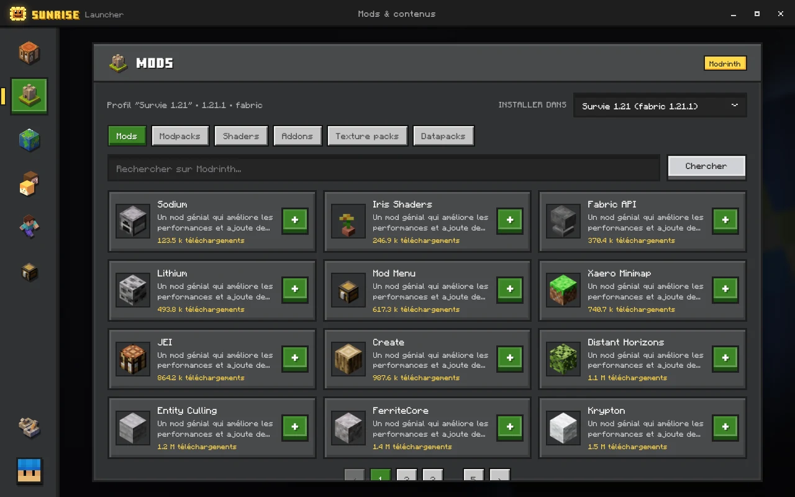</td>
    <td>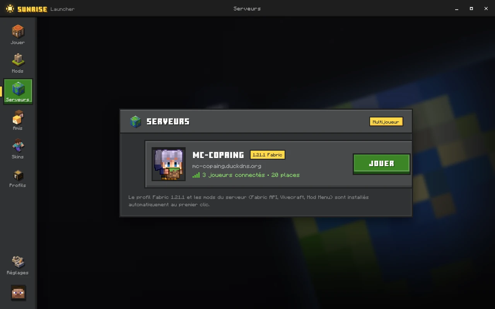</td>
  </tr>
  <tr>
    <td align="center"><b>Mods Modrinth</b></td>
    <td align="center"><b>Serveur mc-copaing</b></td>
  </tr>
  <tr>
    <td>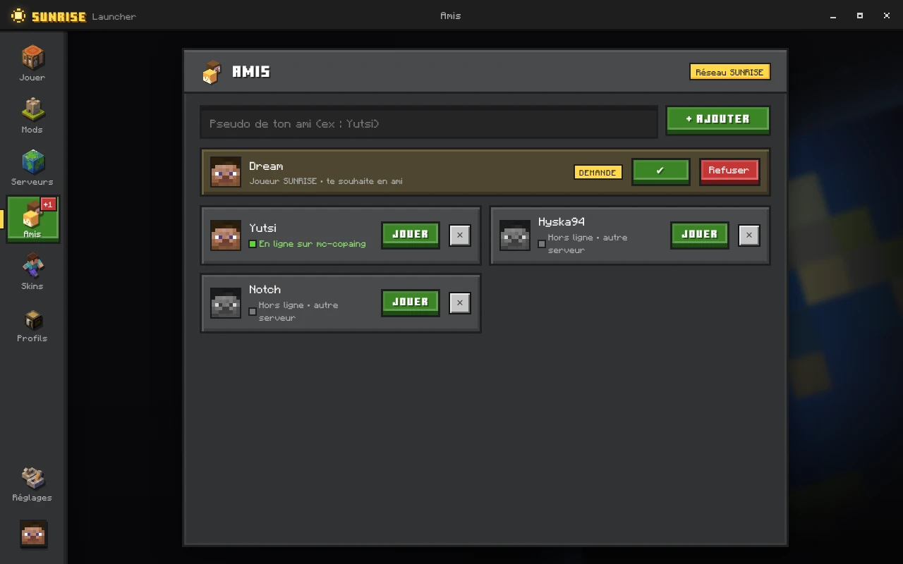</td>
    <td>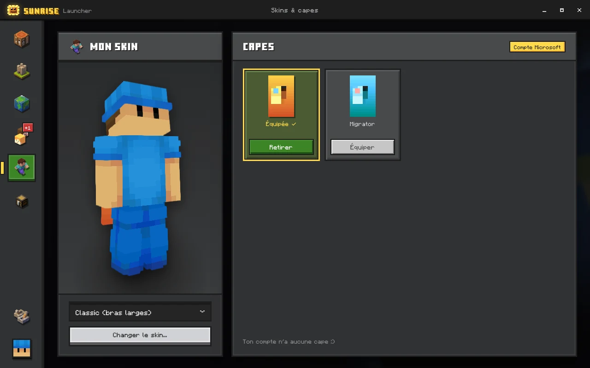</td>
  </tr>
  <tr>
    <td align="center"><b>Amis</b></td>
    <td align="center"><b>Skins & capes</b></td>
  </tr>
  <tr>
    <td>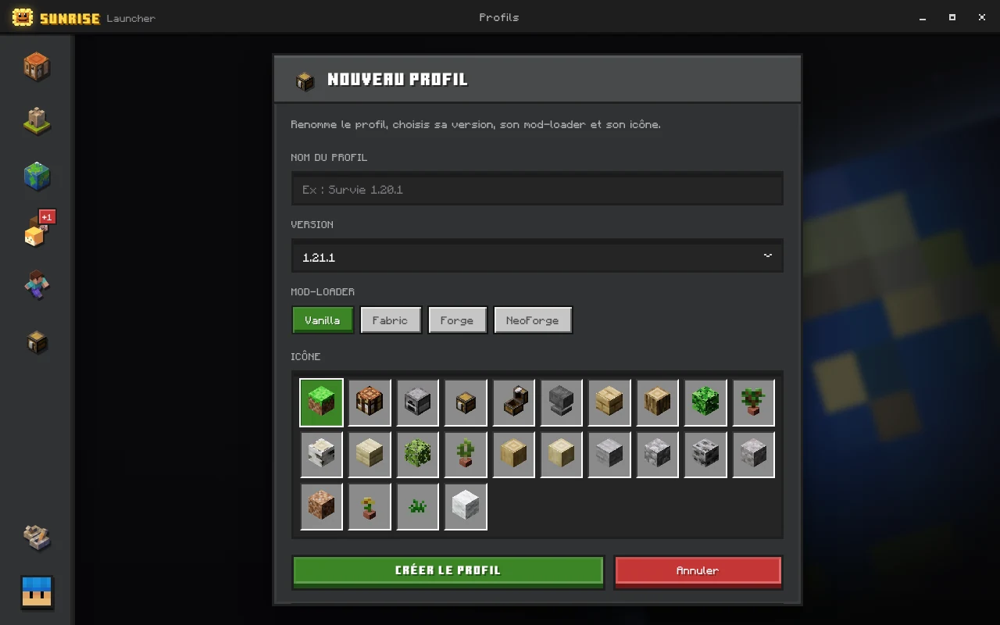</td>
    <td>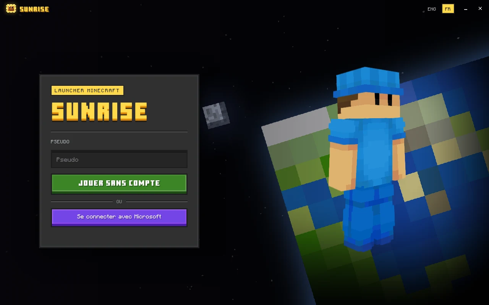</td>
  </tr>
  <tr>
    <td align="center"><b>Éditeur de profil</b></td>
    <td align="center"><b>Connexion</b></td>
  </tr>
</table>

## 🚀 Installation

1. Télécharge **`SUNRISE.Launcher.x.y.z.exe`** dans la [dernière release](https://github.com/YutsiOFF/SUNRISE-Updates/releases/latest).
2. Double-clique dessus : c'est une version **portable**, aucune installation n'est nécessaire.
3. Connecte-toi avec ton compte **Microsoft**, ou entre un simple pseudo pour le solo / LAN.

> Windows peut afficher « Windows a protégé votre ordinateur » au premier lancement (l'exe n'est pas signé) : clique sur **Informations complémentaires → Exécuter quand même**.

Les fichiers du jeu sont rangés dans `%APPDATA%\.sunrisemc`.

## 🔄 Mises à jour

Ce dépôt sert de canal de mise à jour : chaque release contient l'exe du launcher. Au démarrage, SUNRISE compare sa version à la dernière release publiée ici ; si une version plus récente existe, une notification propose de la télécharger puis de relancer le launcher.

## 🙏 Crédits

- Composants d'interface adaptés de **[Minecraft-CSS](https://github.com/Jiyath5516F/Minecraft-CSS)** par Jiyath5516F (licence MPL-2.0).
- Polices « Minecraft Ten » et « Minecraft » fournies avec Minecraft-CSS, complétées avec les accents français.
- Rendu 3D des skins : [skinview3d](https://github.com/bs-community/skinview3d).

SUNRISE n'est pas affilié à Mojang Studios ni à Microsoft. Minecraft est une marque de Mojang AB.
